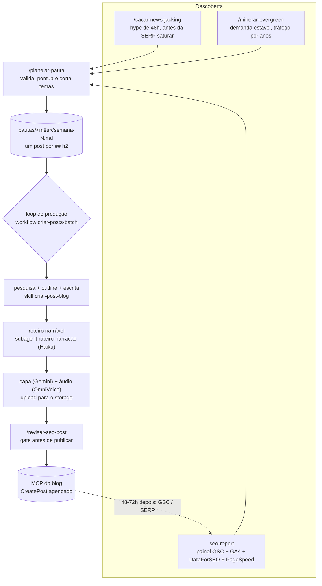

# Beer & Code — pipeline editorial com Claude Code

Este repositório é a "redação" do [blog Beer & Code](https://blog.beerandcode.com.br): um conjunto de skills, subagents, workflows e scripts do [Claude Code](https://claude.com/claude-code) que cobre o ciclo inteiro de um post, da descoberta do tema até a publicação agendada com capa e áudio narrado.

Não há aplicação aqui. O blog em si é um app Laravel separado, que expõe um servidor MCP; este repo é o que conversa com ele.

## O sistema em uma figura



Duas frentes de descoberta alimentam a mesma pauta, de propósito:

| | News-jacking | Evergreen |
|---|---|---|
| Skill | `cacar-news-jacking` | `minerar-evergreen` |
| O que procura | notícia, lançamento ou drama de IA subindo agora | dor recorrente com busca estável ou crescente |
| Janela | 48 horas | 12 a 36 meses de curva |
| Volume de busca ~0 | normal, não reprova | sinal de tema sem demanda |
| Sinal que manda | velocidade e SERP ainda desmontada | durabilidade da curva e viabilidade (KD) |
| Título | número, comparação ou drama | casa a intenção informacional ("o que é X") |
| Papel no blog | pico de tráfego | piso de tráfego quando o hype seca |

## Como rodar o ciclo

Tudo acontece dentro de uma sessão do Claude Code aberta na raiz do repo.

1. **Achar tema.** `/cacar-news-jacking` para o que está quente hoje, `/minerar-evergreen` para o que dura. As duas devolvem um radar ranqueado e a pauta dos aprovados.
2. **Fechar a pauta.** `/planejar-pauta` com a lista de temas. Ela cruza Search Console, DataForSEO e GA4, corta o que não se sustenta e grava os aprovados em `pautas/<mês>/semana-N.md`.
3. **Rodar o loop.** Peça na sessão: "rode o workflow `criar-posts-batch` com o arquivo `pautas/<mês>/semana-N.md`". Cada `## h2` do arquivo vira um post completo, agendado no blog.
4. **Medir.** O painel em `seo-report/` mostra o que pegou e devolve os quick wins para a próxima pauta.

O passo a passo de cada etapa, com os critérios de corte, está em [docs/fluxo-editorial.md](docs/fluxo-editorial.md).

## O que tem no repositório

| caminho | o quê |
|---|---|
| `.claude/skills/cacar-news-jacking/` | detector de temas quentes (`scripts/detect.sh`) + qualificação de SEO |
| `.claude/skills/minerar-evergreen/` | mineração de keywords duráveis com gate de durabilidade |
| `.claude/skills/planejar-pauta/` | validação, scoring e formato fixo da pauta |
| `.claude/skills/criar-post-blog/` | pesquisa, escrita no tom da marca, capa, áudio e publicação |
| `.claude/skills/revisar-seo-post/` | gate de SEO on-page + travas que evitam erro no MCP |
| `.claude/skills/montar-cta-pitch/` | CTA dos posts em 3 níveis de intensidade |
| `.claude/skills/curar-tabnews/` | curadoria de posts do TabNews para comentar |
| `.claude/skills/destilar-aula/` | transforma transcrição longa em curso destilado com áudio |
| `.claude/agents/` | subagents de roteiro de narração (`roteiro-narracao` em Haiku) |
| `.claude/workflows/criar-posts-batch.js` | o loop de produção, com paralelismo e resume |
| `scripts/criar-posts-batch.py` | o mesmo loop em modo headless (`claude -p`), um post por vez |
| `scripts/gerar-audios-existentes.py` | gera áudio para posts que ficaram sem |
| `seo-report/` | painel SEO local (Flask + Chart.js), ver [seo-report/README.md](seo-report/README.md) |
| `pautas/` | pautas reais, organizadas por mês: é a saída do sistema e a entrada do loop |
| `drafts/` | rascunhos de posts |

## Setup

Resumo; o detalhe de cada credencial e de cada MCP está em [docs/setup.md](docs/setup.md).

```bash
cp .env.example .env              # preencha as chaves
cp .mcp.json.example .mcp.json    # preencha URLs, tokens e caminhos

# TTS (pesado: torch + CUDA). Só é necessário para o passo de áudio.
python3 -m venv .venv && .venv/bin/pip install -r requirements.txt

# Painel SEO
python3 -m venv seo-report/.venv && seo-report/.venv/bin/pip install -r seo-report/requirements.txt
```

Dependências de sistema: `claude` (Claude Code), `jq`, `curl`, `python3`, `ffmpeg`, `aws` CLI v2, `pipx`, `uv`/`uvx` e `gcloud`.

Serviços externos:

| serviço | para quê | obrigatório? |
|---|---|---|
| MCP do blog | listar, criar e agendar posts | sim, para publicar |
| Google Search Console | tração real do domínio | sim, para pauta |
| Google Analytics 4 | engajamento depois do clique | sim, para pauta e painel |
| DataForSEO | volume, KD, intenção, SERP, AI search volume | sim, para pauta |
| Gemini API | capa do post | sim, para capa |
| Storage S3-compatible (OCI) | hospedar capa e mp3 | sim, para capa e áudio |
| OmniVoice (local) | áudio narrado com voz clonada | opcional |
| PageSpeed Insights | Core Web Vitals no painel | opcional |
| NewsAPI, GitHub, Reddit | fontes extras do detector | opcional |
| Grok (app) | X Search para o news-jacking, via copiar e colar | opcional |

## Segurança

- **Nenhuma credencial é versionada.** O `.gitignore` é uma allowlist: tudo na raiz é ignorado, só entra o que está liberado. `.env`, `.mcp.json`, `client_secret_*.json` e `application_default_credentials.json` ficam de fora por regra própria.
- O loop headless (`scripts/*.py`) e o painel (`seo-report/server.py`) rodam o Claude com `--dangerously-skip-permissions`. Use só em máquina sua, nunca exposto na rede.
- O default de publicação é **agendado**, nunca publicado direto: `PublishPost` só com OK explícito.
- A amostra de voz do TTS e o playbook comercial do CTA não estão no repo; veja as notas em [docs/setup.md](docs/setup.md#arquivos-que-você-precisa-fornecer).

## Adaptando para o seu blog

As skills têm o blog Beer & Code como constante (domínio, propriedade do GA4, locale `Brazil`/`pt`, tom de voz). Para reutilizar:

1. Troque as "Constantes do projeto" no topo de cada `SKILL.md` e em `seo-report/generate.py`.
2. Reescreva `.claude/skills/criar-post-blog/references/brand-voice.md` e `post-template.md`.
3. Aponte o MCP do blog para o seu CMS. O contrato de tools esperado está em [docs/setup.md](docs/setup.md#mcp-do-blog).
